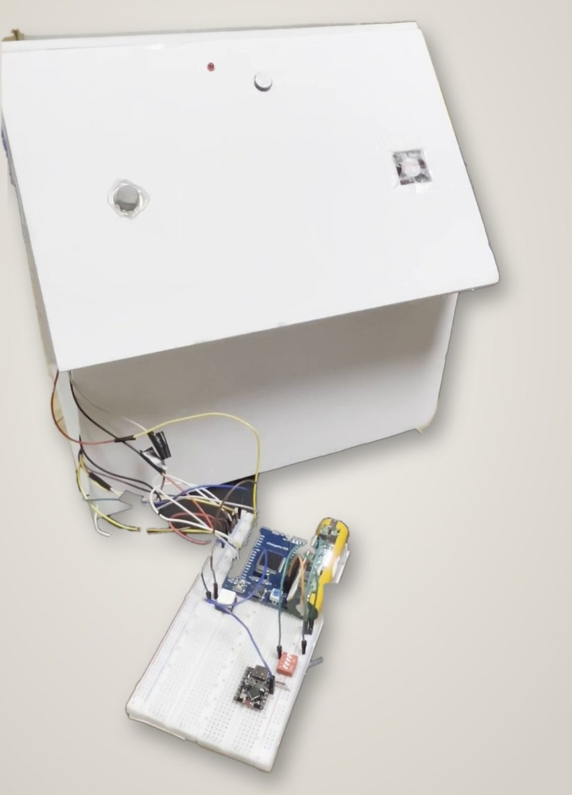
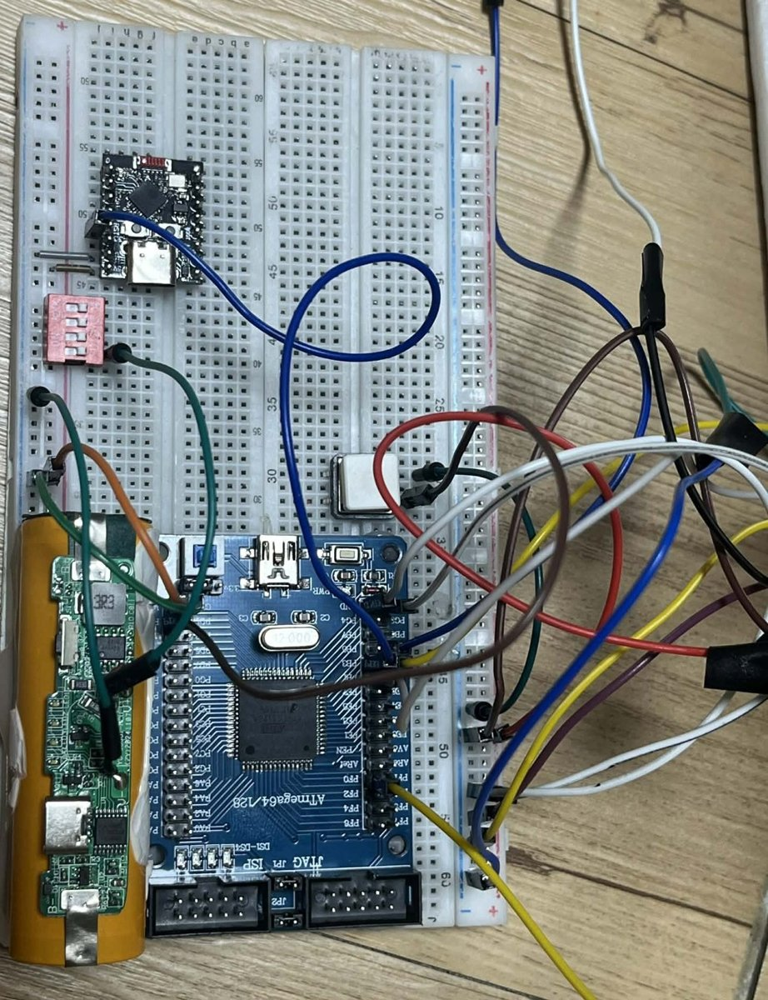
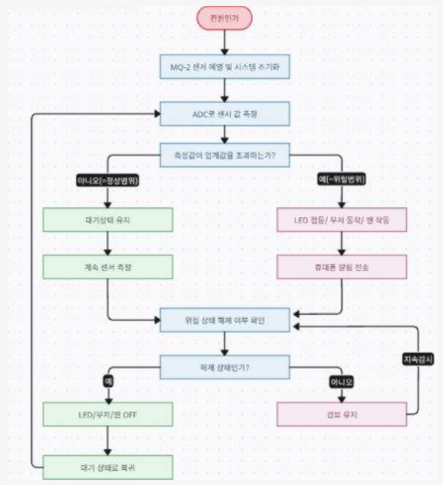
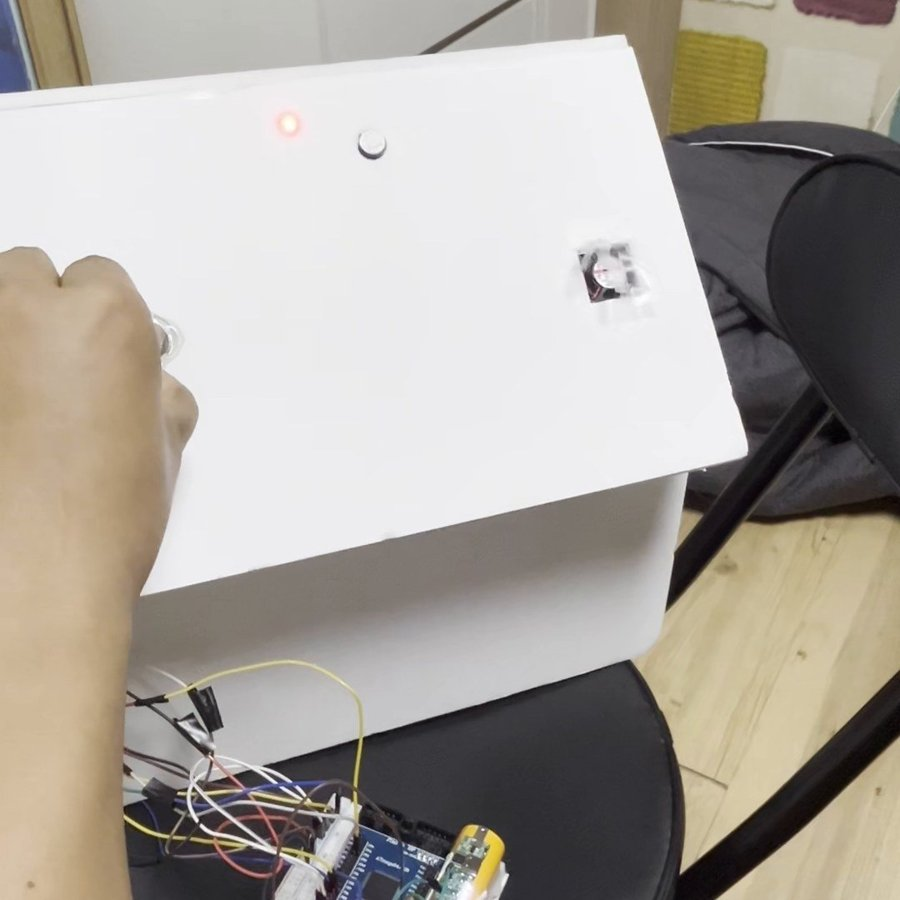
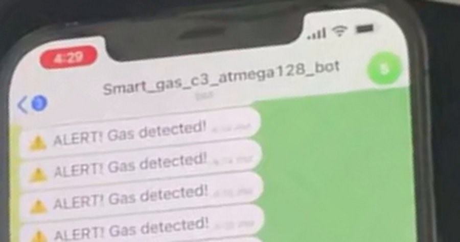

# 가스 누출 감지 경보 및 무선 알림 시스템

ATmega128과 ESP32-C3로 만든 가스 누출 감지기입니다. MQ-2 센서로 가연성 가스를 감지하면 LED·부저·환기팬으로 현장에서 경보를 울리고, 텔레그램으로 스마트폰에 알림을 보냅니다.

<p align="center">
  
</p>

## 프로젝트 개요

| 항목 | 내용 |
|---|---|
| 과목 | 임베디드시스템설계 (2025년 2학기) |
| 기간 | 2025.09 ~ 2025.12 |
| 인원 | 3인 팀 프로젝트 |
| 담당 | HW·SW 전반 총괄 (펌웨어·회로 설계, 센서 데이터 수집·임계값 설정, 발표자료 제작) |

## 주요 기능

- **가스 감지**: MQ-2 센서의 아날로그 출력을 ATmega128의 10비트 ADC로 읽어서 임계값과 비교
- **현장 경보**: 임계값을 넘으면 LED, 부저, 환기팬이 동시에 동작하고, 정상으로 돌아오면 자동으로 꺼짐
- **경보 해제**: 버튼(외부 인터럽트 INT0)을 누르면 경보 해제
- **원격 알림**: ESP32-C3가 경보 신호를 받아 Wi-Fi로 텔레그램 봇 메시지 전송 (경보가 켜지는 순간에만 한 번 전송)

## 시스템 구조

```
[MQ-2 가스센서] --ADC--> [ATmega128] ---> LED / 부저 / 환기팬
[해제 버튼] ----INT0---->     |
                              +--경보 신호--> [ESP32-C3] --Wi-Fi--> Telegram 봇 --> 스마트폰
```

<p align="center">
  
  &nbsp;
  
</p>

## 하드웨어 구성

| 부품 | 역할 |
|---|---|
| ATmega128 | 센서 값 읽기, 임계값 판단, 출력 장치 제어 |
| ESP32-C3 Super mini | Wi-Fi 연결, 텔레그램 알림 전송 |
| MQ-2 | 가연성 가스 감지 센서 (아날로그 출력) |
| LED, 부저 | 시각·청각 경보 |
| DC 팬 | 환기 |
| 택트 스위치 | 경보 해제 |

### 핀 연결

| 장치 | ATmega128 핀 | 비고 |
|---|---|---|
| MQ-2 출력 | ADC0 (PF0) | 기준전압 AVCC(5V) |
| LED | PB0 | |
| 팬 | PB2 | |
| 부저 | PB3 | |
| ESP32-C3 경보 신호 | PB4 | ESP32-C3 GPIO4로 입력 |
| 해제 버튼 | PD0 (INT0) | 내부 풀업, 하강 에지 인터럽트 |

## 폴더 구성

```
├── atmega128/
│   └── main.c                    # ATmega128 펌웨어 (Microchip Studio)
├── esp32c3/
│   └── gas_alert_bot/
│       └── gas_alert_bot.ino     # ESP32-C3 텔레그램 알림 (Arduino IDE)
└── images/
```

## 실행 방법

### ATmega128
1. Microchip Studio에서 GCC C Executable 프로젝트를 만들고 디바이스를 ATmega128로 선택
2. `atmega128/main.c` 내용을 넣고 빌드 (`F_CPU`는 16MHz로 설정되어 있음)
3. 생성된 hex 파일을 보드에 업로드

### ESP32-C3
1. Arduino IDE에 ESP32 보드 패키지를 설치하고 보드를 ESP32C3 Dev Module로 선택
2. 라이브러리 매니저에서 `UniversalTelegramBot`, `ArduinoJson` 설치
3. `gas_alert_bot.ino`에서 아래 값을 본인 것으로 바꾼 뒤 업로드
   ```cpp
   const char* ssid = "YOUR_WIFI_SSID";
   const char* password = "YOUR_WIFI_PASSWORD";
   #define BOT_TOKEN "YOUR_BOT_TOKEN"
   #define CHAT_ID "YOUR_CHAT_ID"
   ```
   > 봇 토큰과 와이파이 정보는 깃허브에 올리지 않도록 주의

## 임계값 설정

MQ-2는 아날로그 출력 센서라서 어디서부터 "위험"인지 정해진 기준이 없습니다. 그래서 평상시 공기와 라이터 가스를 대었을 때의 ADC 값을 반복해서 측정하고, 오경보 없이 빠르게 반응하는 값인 **350**을 임계값으로 정했습니다.

## 동작 결과

<p align="center">
  
  &nbsp;
  
</p>

- 라이터 가스를 대면 LED·부저·팬이 바로 동작
- 스마트폰 텔레그램으로 가스 감지 알림 수신

## 개선할 점

- 경보 해제 버튼을 누른 뒤 다시 감시 상태로 돌아가는 로직 추가 (현재는 해제 후 재경보가 안 됨)
- 사용 환경에 따라 임계값을 바꿀 수 있는 설정 기능
- MQ-2 예열 시간을 고려한 초기 대기 처리
